# GDG on Campus — RV College of Engineering

An interactive, static-first web interface for **GDG on Campus RVCE** built for the **Interface Unlocked UI Design Challenge**.

[**Live Demo**](https://gdgfrontend-jet.vercel.app) &middot; [**Design Note**](./DESIGN_NOTE.md) &middot; [**Events**](https://gdgfrontend-jet.vercel.app/events) &middot; [**Team**](https://gdgfrontend-jet.vercel.app/team)

| Dark Mode (`1440×900`) | Light Mode (`1440×900`) |
| :---: | :---: |
|  |  |

---

## What's Worth Trying

Open the [live demo](https://gdgfrontend-jet.vercel.app) and try these interactive details:

- **Circular Theme Switch:** Click the 3D tactile toggle in the top-right navbar to expand Light &harr; Dark radially from the button using the native View Transitions API, with a dot-matrix sun &harr; moon icon morph.
- **Interactive Track Deck & Fluid Rail:** Move your pointer along the vertical track rail next to the fanned 3D card deck (`Web`, `AI / ML`, `Cloud`, `Android`)—a continuous cubic-Bézier SVG wave tracks your cursor at 60fps and springs back to the active track on leave.
- **Posters &harr; Schedule FLIP Morphing:** On [`/events`](https://gdgfrontend-jet.vercel.app/events), toggle between **Posters** and **Schedule** to watch cards rearrange in place. Filters sync to the URL and respond to keyboard shortcuts (`/` to search, `G`/`L` to switch views, `0`–`4` for tracks, `Esc` to clear).
- **Zero-Backend Event Utilities:** On any [event detail page](https://gdgfrontend-jet.vercel.app/events/linux-and-systems-night), download a working `.ics` calendar invite or copy the session link (with a lightweight 4-color pixel burst), expand the agenda timeline, or click any speaker chip to jump straight to `/team?member=<slug>`.
- **Expressive Team Cards & Mobile Sheet:** On [`/team`](https://gdgfrontend-jet.vercel.app/team), geometric Material 3 mascot portraits track your cursor and blink on hover. Clicking any card opens a desktop slide-over profile or a swipe-to-dismiss bottom sheet on mobile.
- **Keyboard-First `⌘K` / `Ctrl K` Search:** Press `⌘K` (or `Ctrl K`) anywhere to fuzzy-search events, speakers, tracks, and theme switching with arrow-key navigation and a spring-gliding selection bar.

---

## Visual Walkthrough

### Events Directory (`/events`)

| Light Mode (`1440×900`) | Dark Mode (`1440×900`) |
| :---: | :---: |
| 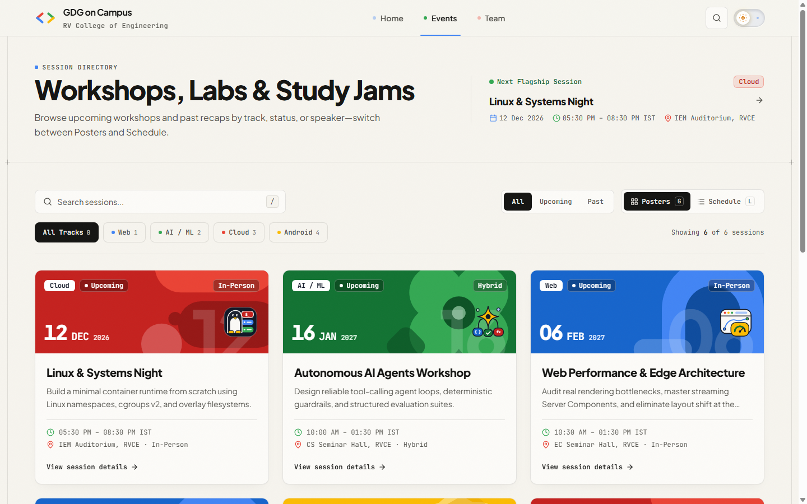 | 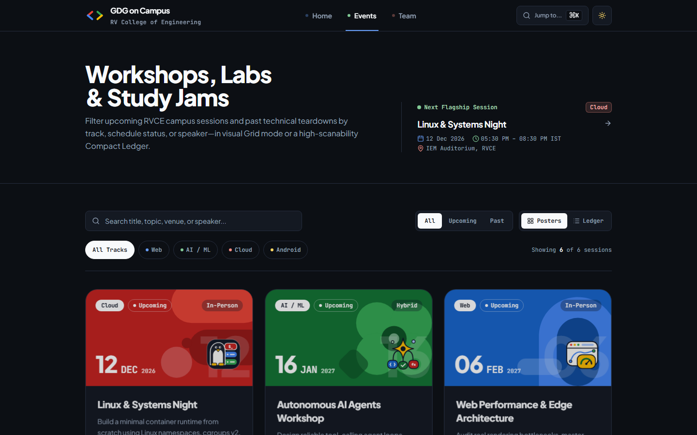 |

### Event Detail (`/events/linux-and-systems-night`)

| Light Mode (`1440×900`) | Dark Mode (`1440×900`) |
| :---: | :---: |
|  | 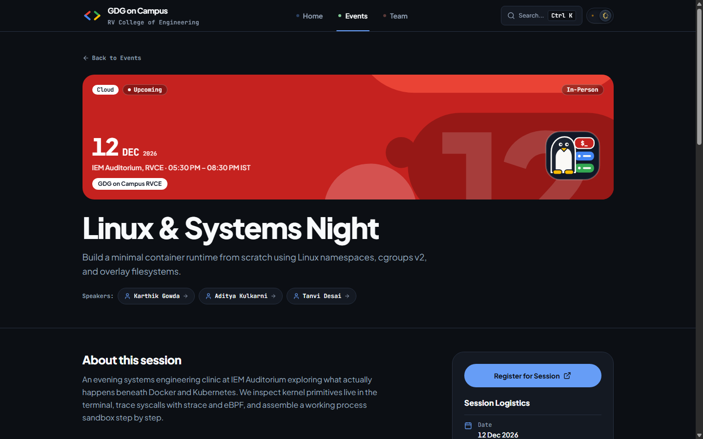 |

### Team Directory & Member Profile (`/team`)

| Team Wall (`1440×900`) | Member Profile Drawer (`1440×900`) |
| :---: | :---: |
| 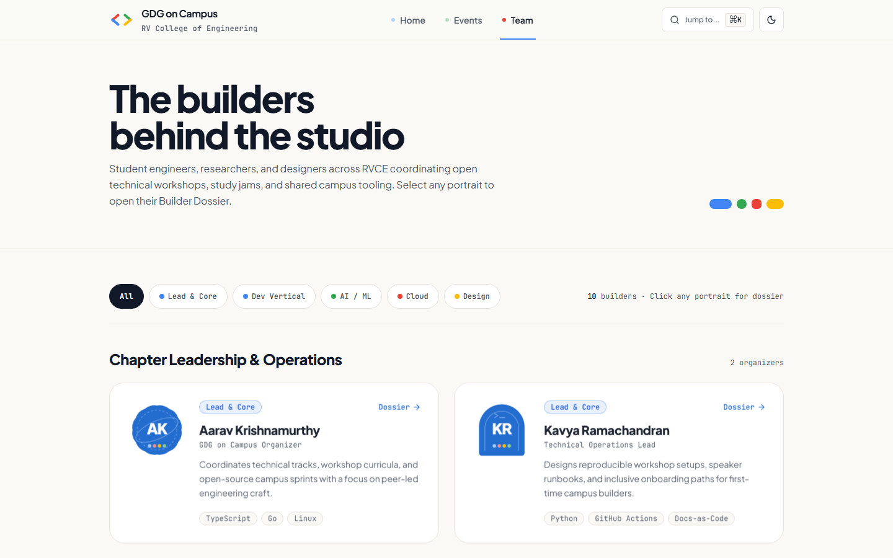 |  |

| Team Dark Mode (`1440×900`) |
| :---: |
| 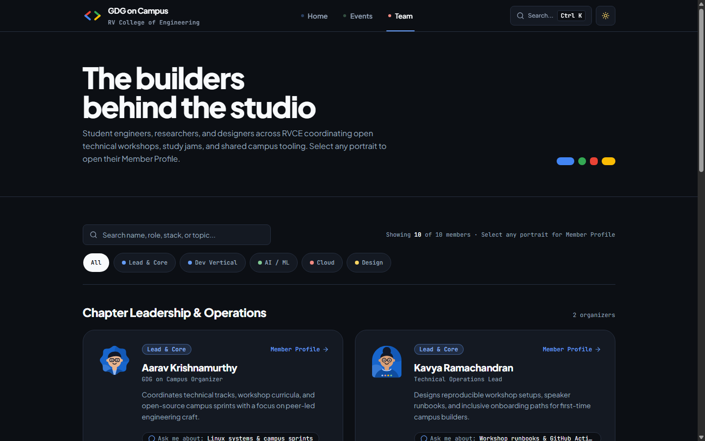 |

<details>
<summary><strong>View Dedicated Mobile Screens (375×812)</strong></summary>

<br />

| Home Light | Home Dark | Events Light | Events Dark |
| :---: | :---: | :---: | :---: |
| 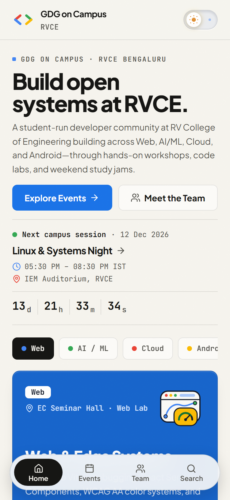 | 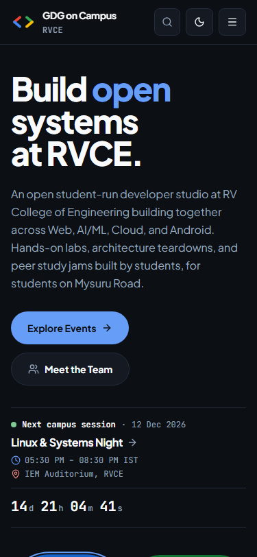 | 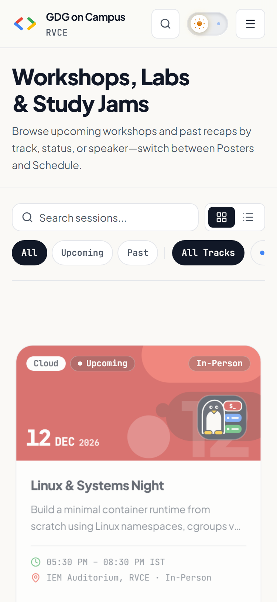 | 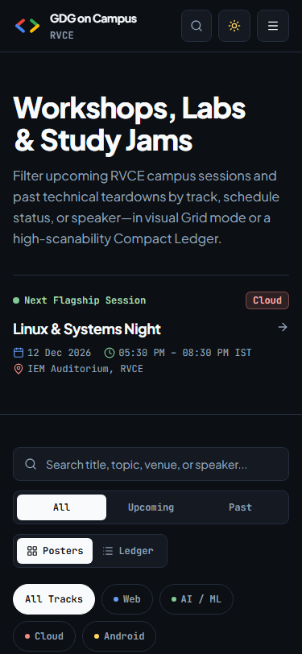 |

| Event Detail Light | Event Detail Dark | Team Light | Team Dark |
| :---: | :---: | :---: | :---: |
| 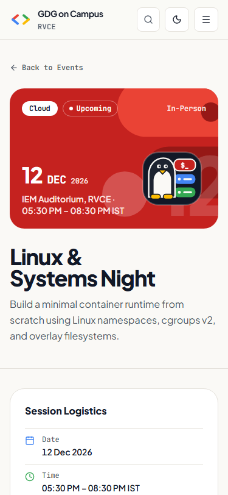 | 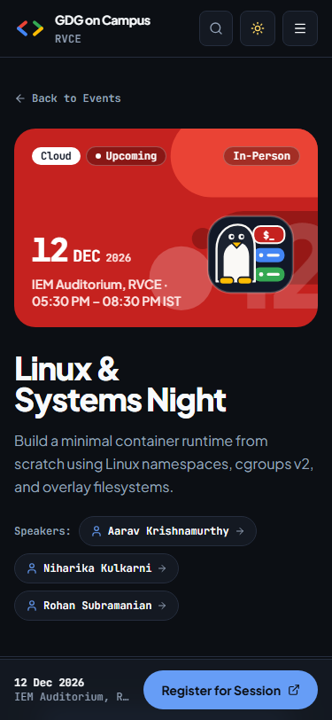 | 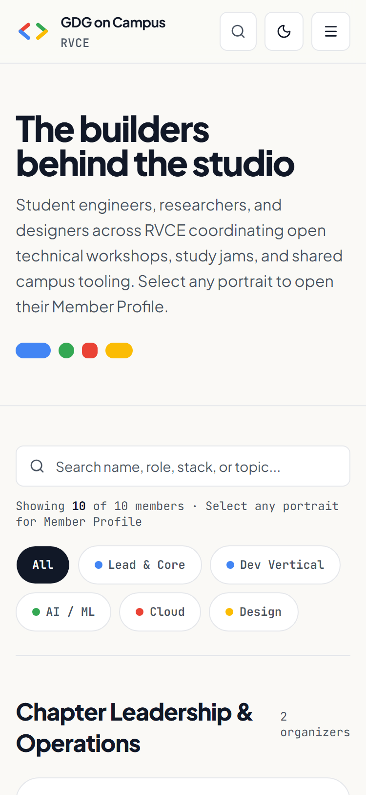 | 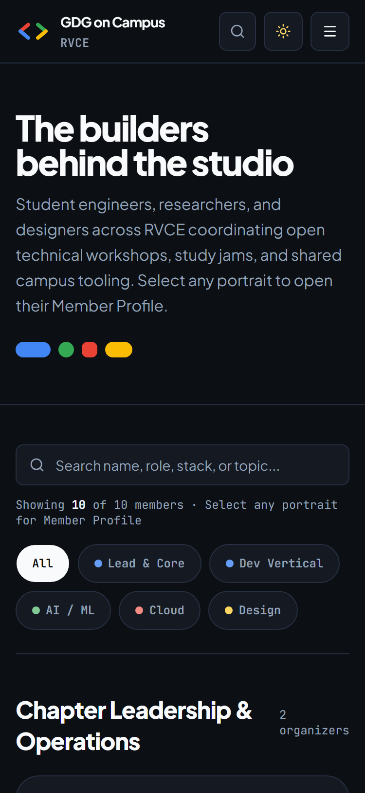 |

</details>

---

## Verified Quality & Challenge Guardrails

| Check | Desktop (`1440×900`) | Mobile (`375×812`) |
| :--- | :--- | :--- |
| **Rendering & Hydration** | Static prerendered, `0` console/hydration errors | Static prerendered, `0` console/hydration errors |
| **Horizontal Overflow** | `0px` across `/`, `/events`, `/events/[slug]`, `/team` | `0px` across `/`, `/events`, `/events/[slug]`, `/team` |
| **Color & Contrast** | WCAG AA in Light & Dark (`#111827` ink on Yellow) | WCAG AA in Light & Dark (`#111827` ink on Yellow) |
| **Motion Safety** | GPU-composited (`transform`/`opacity`), respects `prefers-reduced-motion` | GPU-composited + swipe gestures, respects `prefers-reduced-motion` |
| **Type & Lint Gate** | `tsc --noEmit`, `eslint`, `next build` exit `0` | Dedicated compact mobile layouts with sticky actions |

**Challenge Guardrails:** Zero analytics or tracking scripts, zero RSVP or attendee counters, zero comment boxes or live chat widgets, 100% fictional student names and demo links, and full WCAG AA contrast + `prefers-reduced-motion` support across all four routes.

---

## Tech Stack

| Layer | Choice |
| :--- | :--- |
| **Framework** | [Next.js 16](https://nextjs.org/) (App Router, static generation) & [TypeScript](https://www.typescriptlang.org/) (strict mode) |
| **Styling** | [Tailwind CSS v4](https://tailwindcss.com/) (`@theme inline` + class-based dark mode) |
| **Motion** | [motion](https://motion.dev/) (`motion/react` with async `<LazyMotion strict>` `domMax` + `motion/react-m`), native View Transitions API |
| **Theming** | [next-themes](https://github.com/pacocoursey/next-themes) (`attribute="class"`) |
| **Icons** | [Lucide React](https://lucide.dev/) (`lucide-react`, ISC License) |
| **Typography** | [Plus Jakarta Sans](https://fonts.google.com/specimen/Plus+Jakarta+Sans) & [JetBrains Mono](https://fonts.google.com/specimen/JetBrains+Mono) via `next/font/google` |

---

## Local Setup

```bash
npm install
npm run dev
npm run build
```

After `npm run dev`, open [http://localhost:3000](http://localhost:3000).

---

## Credits & Disclaimer

- **Open-Source Credits:** Next.js, React, Tailwind CSS, Motion, `next-themes`, Lucide Icons (ISC License), and Google Fonts (`Plus Jakarta Sans` and `JetBrains Mono`). All domain illustrations and Chapter Pass credential badges are original inline SVGs.
- **Photo Credits:** Past event and Home recap photographs via Unsplash (Unsplash License) by [Teemu Paananen](https://unsplash.com/photos/bzdhc5b3Bxs) (`past-1.jpg`), [NESA by Makers](https://unsplash.com/photos/IgUR1iX0mqM) (`past-2.jpg`), and [Annie Spratt](https://unsplash.com/photos/QckxruozjRg) (`past-3.jpg`).
- **Additional Docs:** [DESIGN_NOTE.md](./DESIGN_NOTE.md) &middot; [ARCHITECTURE.md](./ARCHITECTURE.md)

> *This is an independent student community chapter website and is not an official Google product. All organizer profiles, speaker names, and event schedules are fictional demo data.*
