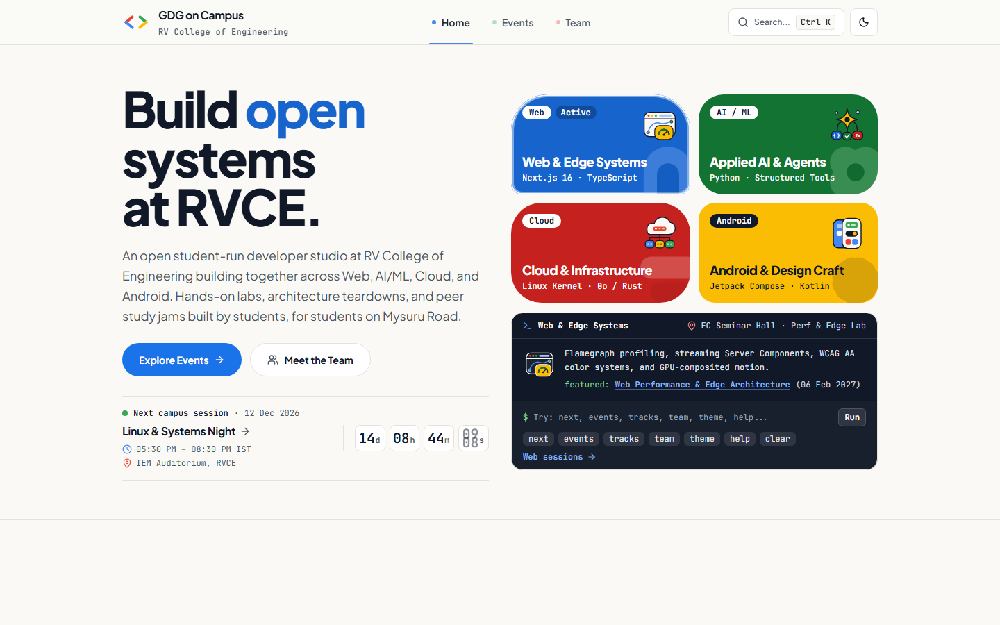
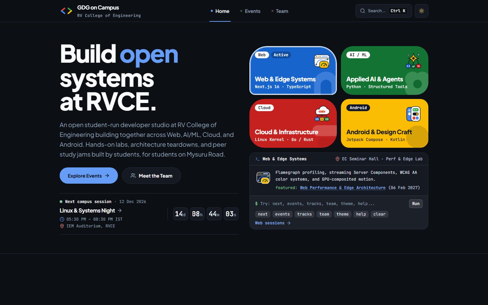
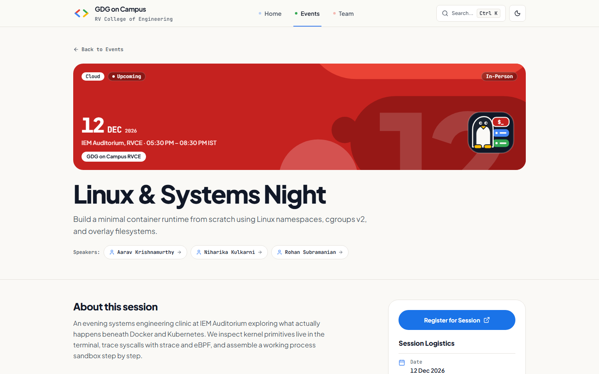
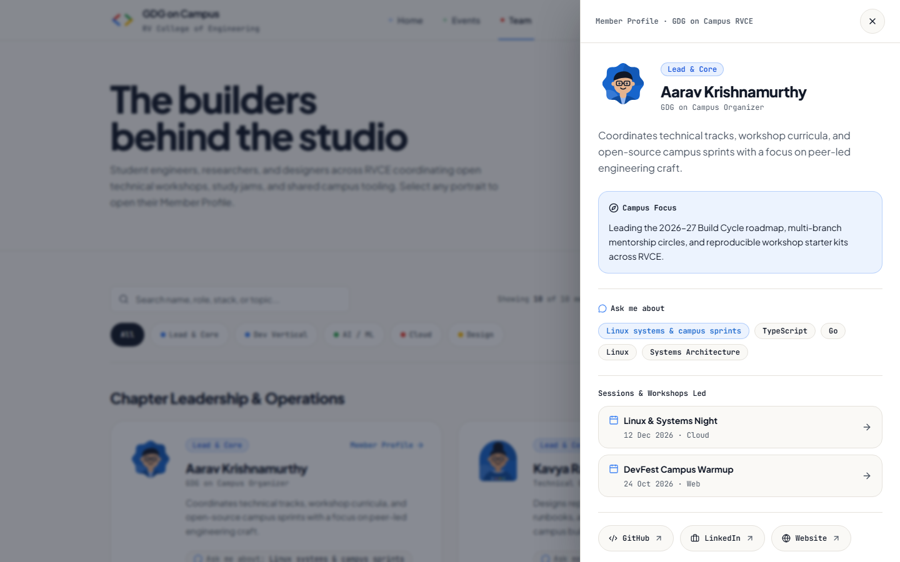

# GDG on Campus RV College of Engineering — Interface Unlocked

A responsive, accessible community web interface for **GDG on Campus RV College of Engineering (GDG on Campus RVCE)** designed around a **Swiss Editorial Grid × Material 3 Expressive** visual language. Built with Next.js 16 App Router, TypeScript strict mode, Tailwind CSS v4, async `motion` (`<LazyMotion strict>`), and original inline SVG artwork.

> **Live Demo:** [https://gdgfrontend-jet.vercel.app](https://gdgfrontend-jet.vercel.app)

---

## Feature Overview

- **Home (`/`)**
  - Oversized `Plus Jakarta Sans` editorial hero paired with a 4-color Material 3 Expressive Track Stage (`Web`, `AI / ML`, `Cloud`, `Android`) featuring shared-element `layoutId` active morphing and pointer-reactive inline SVG `DomainArtwork` illustrations (`linux`, `cloud`, `ai`, `web`, `android`, `devfest`).
  - Real interactive chapter mini-terminal wired to live chapter datasets, Next.js navigation, and theme toggling (`next`, `events`, `tracks`, `team`, `theme`, `help`, `clear`)—zero fake metrics or hardcoded outputs.
  - Hydration-safe mechanical split-flap `CountdownTimer` (`useSyncExternalStore`, fixed-width `tabular-nums`, `CLS = 0`) targeting the next upcoming campus session.
  - Asymmetric 7/5 upcoming events showcase, interactive *DevFest Campus Warmup* Contact Sheet with `layoutId`-morphed lightbox previews, and brand-colored community channels (including official `@gdg_rvce` Instagram and LinkedIn).
- **Events Directory (`/events`) & Event Detail (`/events/[slug]`)**
  - Shared-element FLIP morphing between **Posters** (default grid) and **Schedule** (high-scanability list) via `<LayoutGroup>` and `layout="position"`.
  - URL-synced search, status (`All`, `Upcoming`, `Past`), track filters, and desktop keyboard shortcuts (`/`, `Esc`, `G`, `L`, `0`–`4`).
  - Statically generated detail pages (`generateStaticParams`) with full-bleed `<EventPoster />` banners, top-of-card desktop Register CTA, safe-area sticky mobile Register bar, client-side RFC 5545 `.ics` calendar export, Copy Link feedback, expandable spring agendas, and clickable speaker chips deep-linking to `/team?member=<slug>`.
- **Team Directory (`/team`)**
  - Spring-animated vertical filter pills (`layoutId="team-filter-pill"`), search input, 2-column Chapter Leadership feature row, and 4-column Technical Vertical Leads grid.
  - 10 original self-contained SVG developer persona portraits inside `72px × 72px` morphing M3 masks (`circle`, `arch`, `clover`, `scallop`) with `"Ask me about..."` campus topics.
  - Responsive `MemberSheet` synced to `?member=<slug>`: right-hand slide-over drawer on desktop and draggable swipe-to-dismiss bottom sheet on mobile, with body scroll lock, Escape/backdrop dismiss, focus restoration, and direct links to sessions led.
- **Precision Chrome & Dual Theme System**
  - Sticky navbar with spring `layoutId="nav-indicator"`, 2px four-color CSS Scroll-Driven progress hairline, fuzzy `⌘K` / `Ctrl K` command palette, and circular `document.startViewTransition()` Light/Dark theme reveal (`#FAF9F6` Studio Paper / `#0C0F14` Carbon Slate) with WCAG AA contrast (`--gdg-blue-ink` + `#111827` dark ink on Google Yellow).

---

## Tech Stack & Credits

- **Framework:** [Next.js 16](https://nextjs.org/) (App Router, Static Generation, TypeScript strict mode)
- **Styling:** [Tailwind CSS v4](https://tailwindcss.com/) (`@theme inline` + class-based `@custom-variant dark`)
- **Motion:** [motion](https://motion.dev/) (`motion/react` async `<LazyMotion strict>` with `domMax` + `motion/react-m`, View Transitions API, CSS Scroll-Driven animations)
- **Theming:** [next-themes](https://github.com/pacocoursey/next-themes) (`attribute="class"`)
- **Icons:** [Lucide React](https://lucide.dev/) (`lucide-react`, ISC License)
- **Typography:** Self-hosted [Plus Jakarta Sans](https://fonts.google.com/specimen/Plus+Jakarta+Sans) & [JetBrains Mono](https://fonts.google.com/specimen/JetBrains+Mono) via `next/font/google`

---

## Local Setup

```bash
# 1. Install dependencies
npm install

# 2. Start the development server
npm run dev

# 3. Run typecheck, lint, and production build
npx tsc --noEmit
npm run lint
npm run build
```

Open [http://localhost:3000](http://localhost:3000) in your browser after running `npm run dev`.

---

## Screenshots

Captured from the production build across Light & Dark themes at desktop (`1440×900`) and mobile (`375×812`) in `public/screenshots/`:

| Route | Desktop Light (`1440×900`) | Desktop Dark (`1440×900`) | Mobile Light (`375×812`) | Mobile Dark (`375×812`) |
| :--- | :--- | :--- | :--- | :--- |
| **Home (`/`)** | `home-desktop-light.png` | `home-desktop-dark.png` | `home-mobile-light.png` | `home-mobile-dark.png` |
| **Events (`/events`)** | `events-desktop-light.png` | `events-desktop-dark.png` | `events-mobile-light.png` | `events-mobile-dark.png` |
| **Event Detail (`/events/linux-and-systems-night`)** | `event-detail-desktop-light.png` | `event-detail-desktop-dark.png` | `event-detail-mobile-light.png` | `event-detail-mobile-dark.png` |
| **Team (`/team`)** | `team-desktop-light.png` | `team-desktop-dark.png` | `team-mobile-light.png` | `team-mobile-dark.png` |








---

## Architecture & Documentation

- [DESIGN_NOTE.md](./DESIGN_NOTE.md) — 1-page design rationale covering the Swiss Editorial Grid × Material 3 Expressive direction, motion architecture, and GDG brand compliance.
- [ARCHITECTURE.md](./ARCHITECTURE.md) — Semantic design tokens, repository map, and TypeScript data contracts.
- [DESIGN.md](./DESIGN.md) & [PRODUCT.md](./PRODUCT.md) — Design system tokens, product principles, and accessibility invariants.

---

## Disclaimer

*GDG on Campus RV College of Engineering is an independent student developer community chapter. This website is not an official Google product, and all team/speaker profiles and event schedules are synthetic demo data.*
